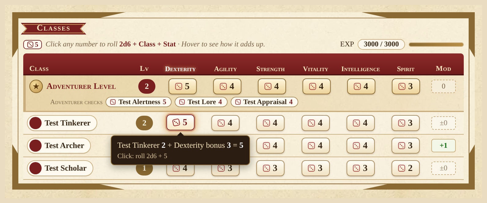
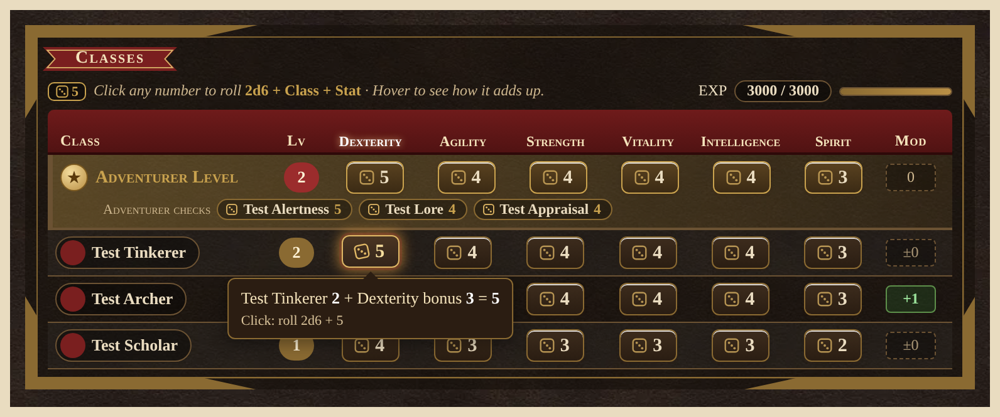

# Sword World 2.5 — Community Edition (sw25-ce) for Foundry VTT


**sw25-ce** is a community edition of the excellent
**[Sword World 2.5 system for Foundry VTT (sw25-fvtt)](https://github.com/jeannjeann/sw25-fvtt) by [Jean.N](https://github.com/jeannjeann)**.
It started as a fork of that system, ported it to Foundry v14, and adds new automation and new player-friendly
sheets and chat cards on top of it. All the groundwork (actors, items, sheets, rolls, translations) is the work
of Jean.N and the original contributors. See [Credits](#credits).

> **ce.19 is the first full release.** It's still a young community project, so back up your world before you
> upgrade, and please report any bugs.



---

## Contents
- [What's new in this edition](#whats-new-in-this-edition)
- [Install](#install)
- [Compatibility](#compatibility)
- [No rulebook content included](#no-rulebook-content-included)
- [Getting started](#getting-started)
- [Credits](#credits)
- [License](#license)

## What's new in this edition

Everything below was added on top of the original system. Full details are in [CHANGELOG.md](CHANGELOG.md).

### Rolling and chat cards
- **Power table rolls built in.** Type `/rp k10@9+3` (or `/r p10 @9 +3`) in chat. No *Chat Commander* module needed.
  Critical re-rolls are handled for you.
- **Attack card.** Clicking a weapon's Accuracy posts one card with Accuracy, Evasion and Damage buttons. It shows
  **HIT / MISS** once both rolls are in.
- **Friendly damage card.** A big total, with the dice, table result, bonus and crits on labelled rows, and a
  breakdown you can expand.
- **Apply panel.** Apply damage or healing to targets: Physical / Magic / Fixed, HP or MP, and ×½, ×2 and other
  multipliers. Defense only counts against physical damage. If you apply to tokens you don't own, a GM must be online.
- **Resist and dodge part picker.** For monsters with several parts (head, body, wings…), pick which part dodges
  or takes the hit.
- Rolls post real roll messages, so dice sounds, *Dice So Nice!* and the roll mode work.
- Token portraits on target rows, and Token HUD condition markers (for tracking only).

### Spells and magic
- **Cast window.** Pick the spell and the options, see the MP cost (Mako Stones included), and pay. The spell
  card rolls power-table damage, and it can apply the damage, healing or "Resisted".
- **Magic tab** reworked: tidy aligned rows, no more "Magic Power NaN", resistance shown in words, and a
  **Show All Spells** list that uses the same Cast button.
- **School ↔ class link.** If a school's drop-down is left empty, it uses your casting class ("Auto (Class)").
- Spells with Active Effects or an Item Macro get **Apply Effect** / **Macro** buttons next to Cast.

### Character sheet
- **Classes card**: a class × stat table. Click any number to roll 2d6 + Class + Stat, or hover to see how it
  adds up (pictured above).
- **Weapons list** with Power / Crit / Bonus, plus Roll Accuracy and Roll Damage for each weapon.
- **Equipment Card** with slots for each body location. The *Accessory* type is now shown as
  **Equippable Gear** ("Gear" for short).
- **No auto-equip.** Gear never equips itself when it lands on a character. Drop it on a slot to equip it.
- **Consumables belt**: click a slot to use a potion or herb. Combat feat slots unlock by level, and you can pick
  a feat by clicking a slot.
- Sensible defaults for Initiative, Monster Knowledge, Accuracy and Evasion.

### NPCs and monsters
- **New stat-block sheet** for NPCs and monsters, with Play and Edit modes. It has a dice button for every
  check, HP/MP for each part, loot rolls and an inventory.
- **Magic section**: monsters and NPCs can cast spells from the stat block through the same cast window.
- **Sword Shards** boost for monsters *and NPCs* (extra HP/MP and better Fortitude/Willpower, marked in purple).
- **Unique skill editor**, weakness reveal, and Hostile / Neutral toggles that set the token's colour.
- **Fellow card**: a player-facing card for NPCs who join the party, with a 1d action roll and an MP bar.
- **Token portrait**: the round portrait shows the token art. Click it to change the token art.

### Under the hood
- A small **rules engine** that class items can use (`system.rules`, grants, choices), with hundreds of unit tests.
- The English manual ([docs/MANUAL-en.md](docs/MANUAL-en.md)) is updated for power rolls and Equippable Gear.



## Install

1. In Foundry's **Setup** screen, open **Game Systems** and click **Install System**.
2. Paste this manifest URL at the bottom and click **Install**:

   ```
   https://github.com/CrestedEcho/sw25-ce/releases/latest/download/system.json
   ```

   This link always points to the **latest full release** (currently **3.0.0-ce.19**). Foundry's **Update**
   button picks up new versions automatically. If you installed one of the old `-test` builds, install again with
   this link to get updates.
3. Create a world and choose **Sword World 2.5 (CE Edition)** as its game system.

The system id is `sw25-ce`, so it installs **next to** the original `sw25` system instead of replacing it.
Every release is listed on the [Releases page](https://github.com/CrestedEcho/sw25-ce/releases).

## Compatibility

| | |
|---|---|
| Foundry VTT | **v14** (minimum 14, verified 14, from `system.json`) |
| Languages | English, 日本語, 한국어. New sw25-ce text is **English only** for now. |
| Original system | Based on sw25-fvtt 2.4.1, which supports Foundry v12–v13. Use the [original](https://github.com/jeannjeann/sw25-fvtt) on v13 or older. |

## No rulebook content included

This system is a **toolkit**: sheets, dice, cards and automation. It does **not** include text, spells, monsters,
items or other content from the Sword World 2.5 rulebooks. The class, spell, item and monster compendiums are
**not** shipped. You (and your players) need the official books to play. Enter the content you need from your
own copies.

The one exception is the bundled **unofficial community power table** (Power 0–100), which the power rolls use.
A filled row in your world's *Reference Power Table* journal still takes priority for that Power.

Sword World 2.0/2.5 is © Group SNE and © KADOKAWA. This is an unofficial fan project, not affiliated with or
endorsed by them.

## Getting started
- New to the system? Start with the original manuals:
  [English](docs/MANUAL-en.md) · [日本語](docs/MANUAL.md).
- Make a character, add a class item (type *Skill*) and some gear, then open the **Classes** card and click a number.
- Roll damage from chat with `/rp k20@10+3` (Power 20, crit on 10, +3).
- Found a bug? Please open an [issue](https://github.com/CrestedEcho/sw25-ce/issues).

## Credits

**Original system: [sw25-fvtt](https://github.com/jeannjeann/sw25-fvtt) by [Jean.N](https://github.com/jeannjeann)**
(MIT License, © 2024 Jean.N). sw25-ce would not exist without it. If you enjoy it, please support the original
author ([Ko-fi](https://ko-fi.com/X8X415YUSP), [OFUSE](https://ofuse.me/o?uid=81619)).

Original contributors, as listed in the original README:
- Translations: Japanese, [Jean.N](https://github.com/jeannjeann); English, [kuouvadis](https://github.com/kuouvadis);
  Korean, [CC8788](https://github.com/CC8788)
- Development support: [kuouvadis](https://github.com/kuouvadis), [HikariNoTsurugi](https://github.com/HikariNoTsurugi),
  [keyslock](https://github.com/keyslock), [Airamhh](https://github.com/Airamhh), [Ryotai](https://github.com/ryotai-trpg)

The original README is kept unchanged at [docs/README-original.md](docs/README-original.md), and the original
version history is in [CHANGELOG.md](CHANGELOG.md).

**Community edition:** [CrestedEcho](https://github.com/CrestedEcho), with a Foundry v14 port and the features above.

**Third-party assets:**
- The original system is based on the Boilerplate system template.
- [MingCute icons](https://www.mingcute.com/), Apache License 2.0, © 2025 MingCute Design.
- [game-icons.net](https://game-icons.net/) icons by Lorc, Delapouite, Sbed and Zeromancer (CC BY 3.0). The full
  list is in [CREDITS.md](CREDITS.md).

## License

[MIT](LICENSE.txt). The original copyright notice (© 2024 Jean.N) and the permission notice are kept unchanged.
sw25-ce's changes are © 2026 CrestedEcho under the same license.

**Changes from the original:** sw25-ce is a modified version of sw25-fvtt 2.4.1. It is ported to Foundry v14,
the system id is `sw25-ce`, and it adds the features listed above. Every change is in the git history and in
[CHANGELOG.md](CHANGELOG.md).
